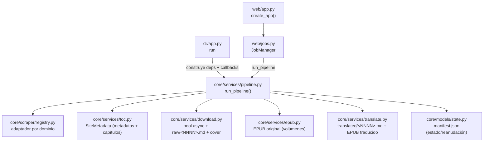
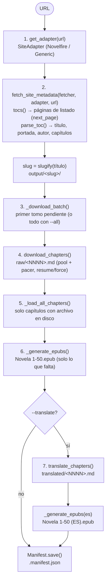
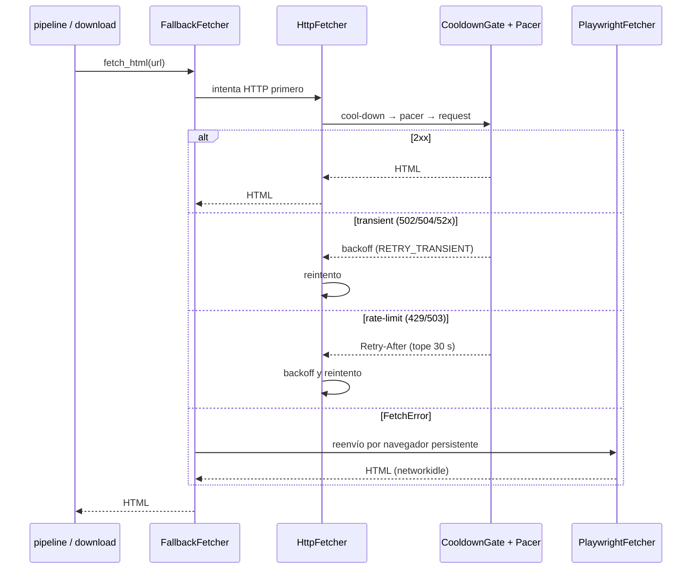
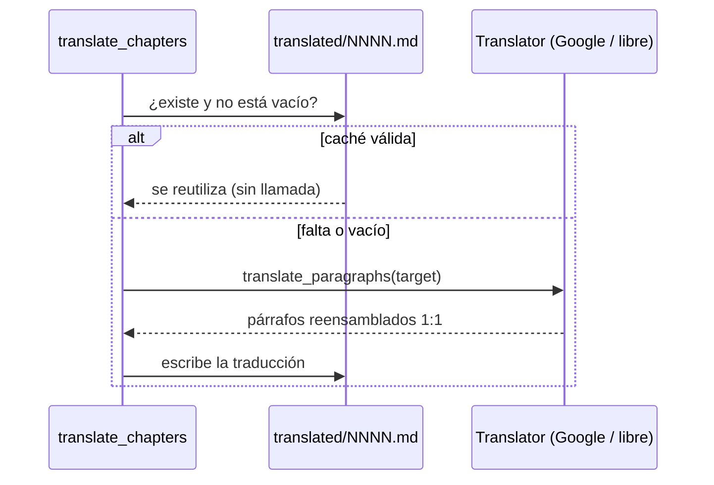
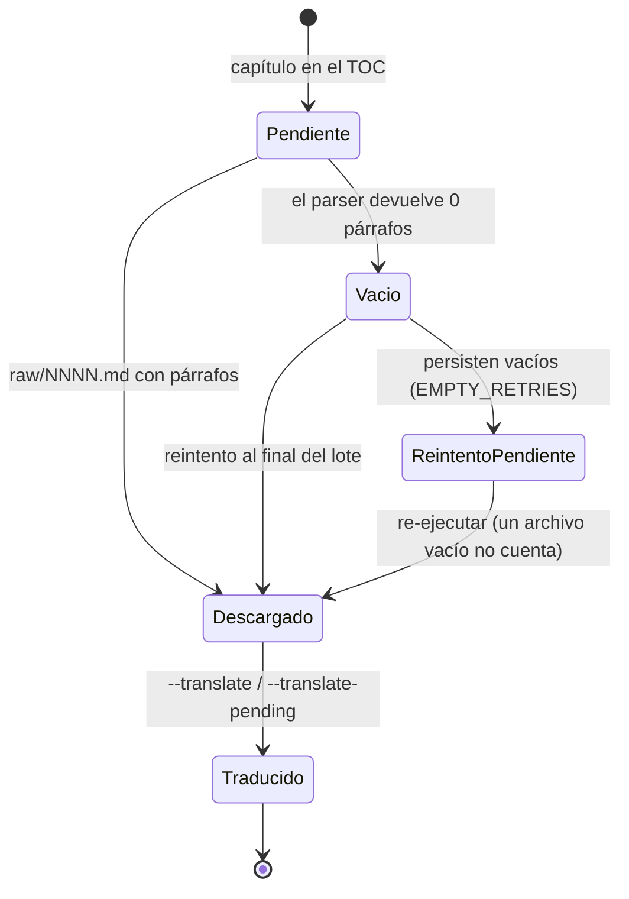

# Arquitectura de novel-cli

Documento técnico de referencia: diseño, módulos, flujo de datos, estado, red, EPUB, traducción, errores y testing.

## 1. Principios de diseño

- **`core/` es dominio puro**: no importa `typer`, `rich` ni lee `argv`. Recibe sus dependencias por inyección (fetcher, translator, directorio de salida). Así se testea sin CLI y se reutiliza desde scripts o una futura API.
- **`cli/` solo orquesta**: parsea args, construye la configuración, conecta las barras de progreso y traduce errores a códigos de salida.
- **HTTP primero, Playwright solo como fallback JS**: los sitios de novelas son server-rendered; un `httpx.AsyncClient` con headers de navegador basta y es mucho más barato.
- **Sin SQLite**: el estado vive en un `.manifest.json` por novela + archivos de capítulo en disco. Portable y editable a mano.
- **Lecciones de Readest**: pacing (~300 ms), retry con backoff, `Retry-After`, cool-down de pool, endpoint gratuito de Google Translate (`translate_a/single` con `client=gtx`), identificador estable de EPUB.

## 2. Layout del proyecto

```
translate_novels/
├── pyproject.toml              # deps, scripts, ruff/pytest
├── docs/                       # documentación (este archivo, uso, features)
├── specs/                      # plan original (00-09)
├── src/novel_cli/
│   ├── cli/                    # ORQUESTACIÓN (typer + rich)
│   │   ├── app.py              # comando por defecto `run` + subcomando `web`, exit codes 0-4
│   │   └── progress.py         # ProgressUI: barras rich conectadas a core
│   ├── web/                    # PRESENTACIÓN WEB (FastAPI + UI vanilla)
│   │   ├── app.py              # create_app() FastAPI, auth por token, main()
│   │   ├── jobs.py             # JobManager: run_pipeline en background + eventos
│   │   ├── routes.py           # API REST (jobs, novelas, EPUBs)
│   │   ├── ws.py               # WebSocket de progreso por job
│   │   ├── templates/index.html# SPA (HTML)
│   │   └── static/             # CSS (design MOSH) + JS vanilla, sin build
│   └── core/                   # DOMINIO PURO (sin typer/rich/argv)
│       ├── config.py           # constantes y default_output()
│       ├── models/
│       │   ├── novel.py        # NovelMetadata, Chapter, SiteMetadata, Volume
│       │   └── state.py        # Manifest (pydantic) load/save
│       ├── scraper/
│       │   ├── base.py         # Protocolos Fetcher y SiteAdapter
│       │   ├── fetcher.py      # HttpFetcher, PlaywrightFetcher, Pacer,
│       │   │                   # CooldownGate, retry/backoff, FallbackFetcher
│       │   ├── registry.py     # dominio → SiteAdapter (fallback genérico)
│       │   └── sites/
│       │       ├── novelfire.py # adaptador NovelFire
│       │       └── generic.py   # heurística TOC estilo Readest chapterList
│       ├── services/
│       │   ├── toc.py          # fetch_site_metadata(): TOC completo
│       │   ├── download.py     # pool async + raw/<NNNN>.md + portada
│       │   ├── epub.py         # build_epub() + generate_volumes()
│       │   ├── translate.py    # GoogleFreeTranslator + chunking + caché
│       │   └── pipeline.py     # orquesta scrape→download→epub→translate→pack
│       └── utils/
│           ├── names.py        # slugify, naming de volúmenes/capítulos
│           └── text.py         # clean_text, guess_chapter_num, split_text_by_words
└── tests/                      # unit tests SIN RED (respx + fixtures)
```

## 3. Flujo de dependencias



`core` nunca importa `rich`: expone callbacks `on_status(str)` y `on_progress(done, total)` que la CLI conecta a `rich.progress` (`cli/progress.py`) y la web a eventos WebSocket (`web/jobs.py` → `web/ws.py`).

## 4. Flujo de datos (pipeline)



## 5. Componentes clave

### 5.1 Modelos (`core/models/novel.py`, `core/models/state.py`)

Dataclasses del dominio:

```python
NovelMetadata(title, author, cover_url, description, language_code="auto", source_url)
Chapter(num, title, url, paragraphs: list[str])
SiteMetadata(metadata, chapters)
Volume(start, end, chapters)
```

`Manifest` (pydantic `BaseModel`, `extra="ignore"`) es el índice/estado en `output/<slug>/.manifest.json`:

```python
Manifest(schema_version, slug, title, author, source_url, language_code,
         cover_path, chapters_total, chapters_downloaded, chapters_translated,
         chapters_empty, chapters_empty_nums: list[int],
         volume_size, translated, epub_original: list[str], epub_translated: list[str],
         created_at, updated_at)
```

`chapters_downloaded` solo cuenta capítulos **con contenido**; los capítulos cuyo
parser devuelve 0 párrafos se consideran **vacíos**: se reintentan al final del
lote de descarga (`download_chapters`, con backoff configurable `EMPTY_RETRIES`)
y, si persisten, quedan en `chapters_empty` / `chapters_empty_nums` como
"pendientes de reintento" (no fallan el job). Se reportan por `on_status`, en el
CLI y en la UI web, y re-ejecutar el mismo comando los vuelve a descargar porque
un archivo vacío no cuenta como "ya descargado".

API: `Manifest.load(slug_dir) -> Manifest | None` y `manifest.save(slug_dir)`.

### 5.2 Config (`core/config.py`)

Constantes de red/retry heredadas de Readest y `default_output()`:

```python
CHAPTER_REQUEST_MIN_INTERVAL_MS = 300   # pacer de descarga
TRANSLATE_REQUEST_MIN_INTERVAL_MS = ...  # pacer traducción: 1500 (google) / 250 (libre), env NOVEL_TRANSLATE_PACER_MS
DEFAULT_TRANSLATE_CONCURRENCY = 1         # traducción en paralelo: default google
LIBRE_TRANSLATE_CONCURRENCY = 4           # default LibreTranslate local
TRANSLATE_MAX_CONCURRENCY = 16            # tope de protección (env NOVEL_TRANSLATE_MAX_CONCURRENCY)
RETRY_TRANSIENT = 2                      # 502/504/timeout → backoff (1s, 2s)
RETRY_RATE_LIMIT = 3                     # 429/503 → backoff base 2s
RETRY_AFTER_MAX_SECONDS = 30.0
MAX_COOLDOWN_SECONDS = 30.0
DEFAULT_VOLUME_SIZE = 50                 # tomos por defecto
DEFAULT_CONCURRENCY = 4
DEFAULT_MAX_WORDS_PER_CHUNK = 400
EMPTY_RETRIES = 3                        # reintentos de capítulos vacíos (backoff EMPTY_RETRY_BACKOFF)
```

Al importar el módulo, `_load_dotenv()` carga un `.env` del directorio de trabajo (o `NOVEL_CLI_ENV_FILE`) en `os.environ` **sin sobrescribir** variables ya exportadas; después se leen todas las constantes. Así la config (p. ej. `NOVEL_TRANSLATE_BACKEND=libre`) puede vivir en un `.env` sin exportar nada al arrancar el CLI o `novel-cli web`.

### 5.3 Scraper (`core/scraper/`)

Protocolos (`base.py`):

```python
class Fetcher(Protocol):
    async def fetch_html(self, url, *, headers=None) -> str: ...
    async def fetch_bytes(self, url, *, headers=None) -> bytes: ...
    async def aclose(self) -> None: ...

class SiteAdapter(Protocol):
    name: str
    def tocs(self, novel_url) -> list[str]: ...
    def parse_toc(self, html, base_url) -> SiteMetadata: ...
    def parse_chapter(self, html, chapter_url) -> list[str]: ...
    def next_page(self, html, base_url) -> str | None: ...
```

`fetcher.py`:

- `HttpFetcher` — `httpx.AsyncClient` con headers tipo Chrome, `follow_redirects=True`, timeout 15 s. Internamente aplica cool-down del pool → pacer → request → retry. Clasifica errores en *transient* (502/504/52x), *rate-limit* (429/503) y resto; honra `Retry-After` (segundos o fecha HTTP) con tope 30 s.
- `Pacer` — mínimo `N` ms entre inicios de requests (compartido por el pool → ~3.3 req/s).
- `CooldownGate` — si un worker recibe 429, frena al resto del pool (evita el "thundering herd").
- `PlaywrightFetcher` — **un único navegador persistente** (lazy, se lanza en el primer fetch), `wait_until="networkidle"`. Nada de `launch()` por llamada.
- `FallbackFetcher` / `get_fetcher()` — HTTP primero; ante `FetchError` reenvía por Playwright; con `--playwright` fuerza PW directamente. Los fallos de PW se envuelven como `FetchError` (→ exit 2).

Secuencia de una petición con clasificación de errores y fallback:



`registry.py` → `get_adapter(url)`: mapa `{dominio: clase}` con `GenericAdapter` como fallback.

Adaptadores (`sites/`):

- `NovelfireAdapter` — selectores `{ .novel-title, .fixed-img .cover img, #chpagedlist .chapter-list li a, #chapter-container #content p }`; `tocs()` → página de portada + `/chapters`; `next_page()` lee `.page-link[rel="next"]`.
- `GenericAdapter` — heurística TOC estilo Readest `chapterList.ts`: enlaces con texto numerado (`Chapter N`, `第N章`, `Capítulo N`) o href con digit runs; elige el contenedor más profundo con la mayoría de candidatos; metadatos de `og:title`/`og:image`/`meta[name=author]`; dedupe y orden por número.

`services/toc.py` → `fetch_site_metadata()` recorre las páginas de listado del adaptador y fusiona metadatos + capítulos.

### 5.4 Descarga (`core/services/download.py`)

- `download_chapters(...)` — pool async (`asyncio.Semaphore(concurrency)`) + `Pacer` compartido. Cada worker: `fetcher.fetch_html(url)` → `adapter.parse_chapter()` → escribe `raw/<NNNN>.md`. Respeta reanudación por **existencia de archivo**; con `force` re-descarga todo el lote.
- `is_chapter_empty(paragraphs)` — un capítulo es vacío si el parser devuelve 0 párrafos con contenido. Los vacíos **no** cuentan como descargados y se **reintentan al final del lote** (secuencial, con backoff `EMPTY_RETRY_BACKOFF`). Si persisten quedan en `manifest.chapters_empty(_nums)` y se reportan; re-ejecutar el comando los re-descarga porque un archivo vacío no cuenta como hecho.
- `download_cover(...)` → `cover.<ext>` (jpg/png/webp...).
- `load_chapter(path, num, url)` — reconstruye un `Chapter` desde `raw/` o `translated/` (formato: `# título` + párrafos separados por `\n\n`).

### 5.5 EPUB (`core/services/epub.py`)

- `build_epub(*, title, author, language, identifier, chapters, cover_path, translated=False, include_end_page=True) -> bytes` — genera `content.opf`, `toc.ncx`, `nav.xhtml`, un XHTML por capítulo (`<h1>` + un `<p>` por párrafo, 1:1), portada local (imagen) o SVG generado, `spine` ordenado por número, `language` correcto y `identifier` estable. Con `include_end_page` añade `end.xhtml` al final del spine: `FIN`/`THE END` según el idioma + ficha del tomo (título, rango `start–end`, autor, idioma de traducción si `translated`); la página queda **fuera del TOC**.
- `stable_identifier(source_url)` — hash SHA-1 de la URL → `urn:novel-cli:<hash>` (re-imports deterministas).
- `generate_volumes(chapters, volume_size)` — divide en `Volume(start, end, chapters)`; el último tomo puede ser corto; `None` → un solo volumen.

En el pipeline (`pipeline.py`), `_generate_epubs` acepta `rebuild` (default `False`): con `rebuild=True` **reescribe los EPUB existentes aunque haya `resume`** (lo usan las vías de traducción, para que los EPUB `(ES)` reflejen siempre las traducciones actuales). Tras generar, `_cleanup_orphan_epubs` **borra del disco los `*.epub` que ya no están en `epub_original`+`epub_translated`** (restos de generaciones anteriores). Las vías de solo-traducción refrescan además `chapters_empty` desde el disco (`refresh_empty_counts`).

`_build_epub_chapters(reference, chapter_dir, placeholder)` construye la lista de capítulos de un EPUB **del mismo tamaño/orden que la lista raw de referencia**: los archivos existentes se cargan (y si quedaron vacíos se sustituyen por el placeholder), y los que faltan (capítulos sin traducir) se crean con el placeholder. Así los tomos del EPUB traducido **se alinean** con los del original y no hay páginas en blanco (`EMPTY_PLACEHOLDER_EN`/`EMPTY_PLACEHOLDER_ES`).

`rebuild_volumes(slug_dir, volume_size)` reconstruye los EPUBs con un nuevo tamaño de tomo **sin red** (desde el disco): valida el tamaño (`None` = un único EPUB/ALL, o `>= 1`), actualiza `manifest.volume_size`, regenera original y traducido con `rebuild=True`, limpia huérfanos y refresca `chapters_empty`. Es la base del endpoint `POST /api/novels/{slug}/volume-size`.

### 5.6 Traducción (`core/services/translate.py`)

- `GoogleFreeTranslator` — `GET translate.googleapis.com/translate_a/single?client=gtx&dt=t&sl=auto&tl=<target>&q=<texto>`; concatena los `segment[0]` de `data[0]`. Retry/pacing propios (pacer 1500 ms por defecto, backoff ante 429/5xx honrando `Retry-After`). El `Translator` acepta `target` por llamada (default `es`), igual que LibreTranslate (`payload["target"]`).
- `translate_paragraphs()` — traduce párrafo a párrafo con chunking (`split_text_by_words`, ~400 palabras) y **reensamblado 1:1** (los párrafos vacíos no llaman al endpoint).
- `translate_chapters(...)` — caché en `translated/<NNNN>.md`; solo traduce lo que falta; actualiza `manifest.chapters_translated`. **Paraleliza capítulos** con `concurrency` (patrón `asyncio.Semaphore` + `gather`, igual que la descarga); el `Pacer`/`CooldownGate` compartidos limitan el ritmo global de peticiones incluso en paralelo. Los capítulos **vacíos** (sin contenido en `raw/`) no se traducen ni se marcan como traducidos; un `translated/<NNNN>.md` **vacío** (heredado de cuando el raw estaba vacío) **no cuenta como ya traducido** — si el raw tiene contenido se re-traduce, y si el raw sigue vacío se limpia (para que el EPUB traducido no incluya capítulos en blanco).
- `OllamaTranslator` — stub opcional (no es el backend por defecto).

Decisión de caché por capítulo (no re-traduce lo ya hecho; un `translated/` vacío no cuenta):



**Idioma destino**: `config.TRANSLATE_TARGET_LANGUAGES` (código→etiqueta) es la lista curada (`es, en, fr, de, it, pt, ru, ja, ko, zh`); default `config.translate_target_default()` (env `NOVEL_TRANSLATE_TARGET`). El target viaja por `run_pipeline(..., target)` → `translate_chapters(target=...)` y se persiste en `manifest.translated_language` (compatible con manifests viejos: `translated=True` sin idioma ⇒ `es`). El sufijo de los EPUB traducidos y el `language=` del metadato usan el target (no `(ES)` fijo); `rebuild_volumes` los reconstruye con el idioma guardado.

Concurrencia y protección (`core/config.py`): `translate_concurrency_default()` devuelve **1** para `google` y **4** para `libre` (o `NOVEL_TRANSLATE_CONCURRENCY` si se define). `effective_translate_concurrency(requested)` es la capa de protección: **fuerza 1** si el backend es `google` (evita rate-limit) y limita a `TRANSLATE_MAX_CONCURRENCY` (16) para `libre`. El pacer default es 1500 ms (google) / 250 ms (libre), sobrescribible por `NOVEL_TRANSLATE_PACER_MS`. Ambos se aplican en `run_pipeline` (y en `--translate-pending`).

### 5.7 Pipeline (`core/services/pipeline.py`)

`run_pipeline(...)` orquesta todo. Decisiones clave:

- **Descarga por tomos**: `_download_batch()` devuelve el primer tomo pendiente (primeros `volume_size` capítulos del TOC sin archivo en `raw/`) salvo `--all` o `volume_size=None`. Re-ejecutar avanza al siguiente tomo.
- **EPUB incremental**: `_generate_epubs()` escribe solo los EPUB que falten (o todos con `--force`); al re-ejecutar añade `Novela 51-100.epub` sin reescribir `1-50`.
- `_load_all_chapters()` carga solo capítulos con archivo en disco → nunca genera EPUB vacíos de tomos no descargados.

### 5.8 CLI (`cli/app.py`, `cli/progress.py`)

- `cli/app.py` expone dos apps typer separadas y `main()` despacha: `novel-cli <url>` (comando por defecto `run`) y `novel-cli web`.
- `run(url, -o, -v, -t, --resume/--no-resume, -f, --all, -p, -c, -V)`.
- Validación: URL http(s), `-v ∈ {50, 100}`, `-c ≥ 1` → exit 1.
- `ProgressUI` (`cli/progress.py`) conecta `on_status`/`on_progress` de core a barras `rich.progress` (descarga, traducción, EPUB).

### 5.9 Web (`web/`)

Capa de presentación web (FastAPI + Uvicorn) que reutiliza `core` tal cual. `web/` no contiene lógica de dominio:

- `jobs.py` — **JobManager**: cada job lanza `run_pipeline` como `asyncio.create_task` dentro del event loop de Uvicorn (un job activo a la vez). Construye su propio fetcher/translator por ejecución y los cierra en `finally`. Los callbacks `on_status`/`on_progress` del pipeline publican **eventos** (`{type, phase, done, total, message}`) a un buffer + suscriptores.
- `routes.py` — API REST: `GET /api/jobs` (lista de jobs con su `state`, para que la UI detecte un job activo), `POST /api/jobs` (valida como el CLI; acepta `target_language`), `GET /api/jobs/{id}`, `POST /api/jobs/{id}/cancel`, `GET /api/novels`, `GET /api/novels/{slug}` (incluye `translated_language`), `GET /api/novels/{slug}/epub/{file}`, `GET /api/novels/{slug}/cover`, `POST /api/novels/{slug}/sync` (hereda idioma y tamaño de tomo), `POST /api/novels/{slug}/retranslate` (solo-traducción de pendientes con opciones del manifest; acepta `{target_language}` y **fuerza la re-traducción** si el idioma cambia), `POST /api/novels/{slug}/volume-size` (cambia el tamaño de tomo y reconstruye los EPUBs desde el disco), `POST /api/novels/{slug}/rebuild` (reconstruye los EPUBs con el mismo `volume_size`, sin cambiar nada: aplica mejoras del builder como la página final), `GET /api/config` (incluye `translate_backend`, `translate_languages` y `default_translate_target`).
- `ws.py` — WebSocket `/api/jobs/{id}/ws`: reenvía los eventos del job al cliente (reusa el mismo mecanismo de callbacks que `rich`).
- `app.py` — `create_app(output_dir)` monta static/templates y aplica auth opcional por token (`NOVEL_WEB_TOKEN`, cabecera `X-Auth-Token`). Sirve **4 páginas** (`GET /`, `/biblioteca`, `/ayuda` y `/novela/{slug}`). `main()` arranca Uvicorn (`--host`/`--port`/`--no-browser`).
- `templates/` + `static/` — UI **multi-página** responsive sin build (CSS con tokens de `DESIGN.md` + JS vanilla por página): `index.html` (descarga + progreso + novelas recientes), `library.html` (grid de portadas), `novel.html` (ficha de novela con acciones y EPUBs) y `help.html` (guía estática de acciones). El JS se parte en módulos compartidos: `common.js` (auth/api/toast/config/escapeHtml), `jobs.js` (job lock, WebSocket + polling, panel de progreso, cancelar, sync/retraducción) y uno por página (`app.js`, `library.js`, `novel.js`). Las páginas leen los datos de la API existente; el slug de la ficha lo obtiene `novel.js` de la ruta.

El **sync** (`POST /api/novels/{slug}/sync`) es el "obtener nuevos capítulos" de la biblioteca: carga el `Manifest` del slug, valida su `source_url` y crea un job con `url = manifest.source_url`, `resume=true`, `all=false`, heredando `volume_size` y `translate` (si la novela ya se traducía, los nuevos capítulos también se traducen). Como el pipeline con `resume` y sin `--all` descarga el **siguiente tomo pendiente**, el sync avanza la novela un tomo sin re-pegar la URL.

Sobre puertos: la web escucha en **un único puerto** (default `8000`). El WebSocket no abre otro puerto: usa el mismo del servidor HTTP en `/api/jobs/{id}/ws` (upgrade HTTP→WS). Los demás números que aparecen en los logs de Uvicorn (p. ej. `127.0.0.1:41570`) son **puertos efímeros de origen** del cliente, asignados por el SO a cada conexión TCP y cambiantes en cada request; no hay que abrirlos en el firewall.

## 6. Estado en disco y reanudación

```
output/<slug>/
├── .manifest.json   # índice/estado
├── cover.jpg
├── raw/0001.md ... raw/NNNN.md       # idioma original
├── translated/0001.md ...            # traducción (si -t)
└── Novela 1-50.epub ...              # + (ES) si -t
```

Reglas:

- La **existencia del archivo** es la fuente de verdad de "ya descargado/traducido"; el manifest es caché/índice.
- `--resume` (default): se saltan fases completas y no se reescriben EPUB existentes.
- `--force`: re-descarga y re-traduce todo.
- `--no-resume`: no consulta el manifest, pero la existencia de archivos sigue evitando re-descargas.
- Tras cada fase se escribe el manifest (`chapters_total`/`chapters_downloaded`/`chapters_translated` consistentes).

Ciclo de vida de un capítulo (la existencia de archivo en disco manda; el manifest es caché):



## 7. Errores y códigos de salida

| Código | Origen |
|---|---|
| `0` | Éxito |
| `1` | Validación de entrada |
| `2` | `FetchError` / `DownloadError` (red/descarga, incl. fallback PW) |
| `3` | `TranslateError` |
| `4` | `PipelineError` u otro inesperado (EPUB/manifest) |

Excepciones de dominio: `FetchError`, `FetchRateLimitedError`, `DownloadError`, `TranslateError`, `PipelineError`. `core` las lanza; `cli/app.py` las mapea a códigos.

## 8. Concurrencia y pacing

- Descarga: `asyncio.Semaphore` (default 4 workers) + `Pacer` compartido (300 ms) → ~3.3 req/s agregadas.
- Traducción: `asyncio.Semaphore` (default 1 google / 4 libre, `-tc`) + `Pacer` compartido (1500 ms google / 250 ms libre). El pacer limita el ritmo **agregado global** de peticiones, por lo que el paralelismo solapa latencia/CPU sin disparar el rate global.
- Protección: `effective_translate_concurrency()` fuerza 1 para `google` (no quemar el endpoint gratuito) y topa en `TRANSLATE_MAX_CONCURRENCY` (16) para `libre`.
- Cool-down de pool ante 429: `CooldownGate` compartido (tope 30 s) frena a todos los workers.

## 9. Testing

- **Unit tests sin red**: fixtures HTML en `tests/fixtures/` (`novelfire_cover.html`, `novelfire_toc.html`, `novelfire_chapter.html`, `generic_toc.html`, `generic_no_toc.html`).
- **HTTP falso con `respx`**: `test_fetcher.py` (429/Retry-After/transient/cool-down/fallback), `test_download.py`, `test_translate.py`.
- **Web con `TestClient` de FastAPI** (`test_web.py`): se mockea `web.jobs.run_pipeline` para no tocar la red; se prueban rutas, validación, auth por token y descarga de EPUB.
- `pytest-asyncio` (`asyncio_mode="auto"`) para las funciones async.
- `pytest.ini_options.addopts = "-m 'not integration'"`: Playwright queda fuera del CI unitario (marcas `integration` reservadas).
- Comandos: `uv run pytest -q` y `uv run ruff check .` (rules `E,F,I,UP,B`, line-length 100, target py311).

## 10. Convenciones de código

- Modelos de dominio: `@dataclass`; estado: `pydantic`.
- Interfaces intercambiables: `typing.Protocol` (`Fetcher`, `SiteAdapter`, `Translator`).
- `core` no importa `typer`/`rich`/`argv`; el progreso entra por callbacks.
- Naming estable en `core/utils/names.py` (`slugify`, `volume_name`, `chapter_filename`).
- `from __future__ import annotations`, docstrings en módulos, `# noqa` solo cuando aporta.